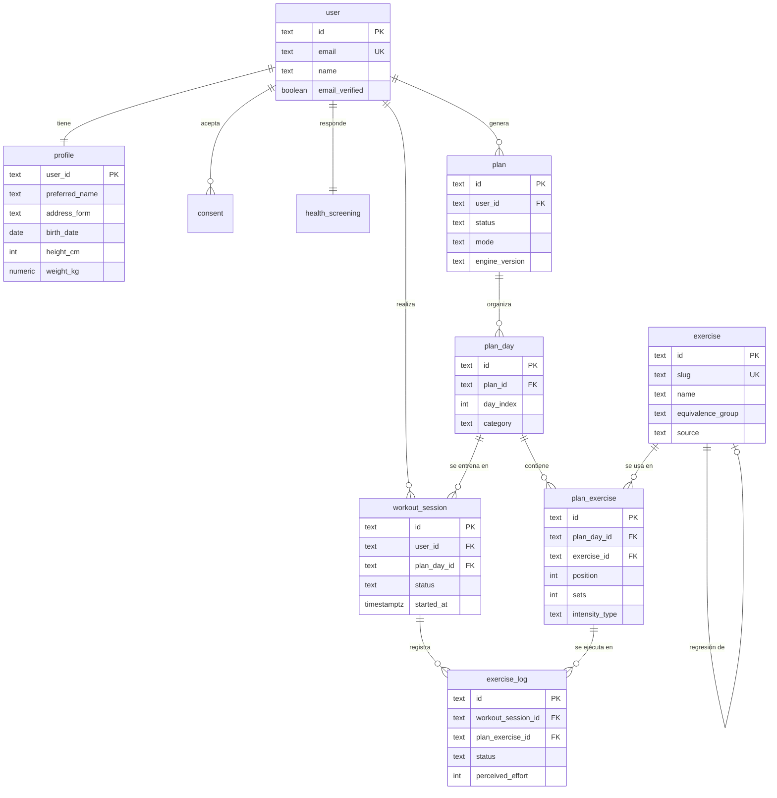

# Modelo de datos inicial

> **Estado:** propuesta · **Issue:** #2 · **Implementación:** llega con el scaffolding y las
> migraciones de Drizzle. Este documento no contiene SQL.

Diseño del MVP según el brief (§3). El objetivo es que quepa en PostgreSQL sin tablas de más
y que los datos de salud se puedan borrar en bloque cuando alguien elimine su cuenta.

## 1. Diagrama

Tablas de Better Auth omitidas del diagrama para no ensuciarlo: `session`, `account` y
`verification` cuelgan de `user` y las genera su CLI. No se modifican a mano salvo por
`additionalFields` documentados.

## 2. Entidades

### Autenticación (Better Auth)

| Tabla | Campos clave | Notas |
|---|---|---|
| `user` | `id`, `name`, `email` (único), `emailVerified`, `image`, timestamps | `name` es el nombre de la cuenta; **no** se usa para saludar |
| `session` | `id`, `token`, `userId`, `expiresAt`, `ipAddress`, `userAgent` | Sesión de login, no de entrenamiento |
| `account` | `id`, `providerId`, `accountId`, `userId`, `password` | Correo y contraseña en el MVP |
| `verification` | `id`, `identifier`, `value`, `expiresAt` | Recuperación de contraseña |

### `profile` — 1:1 con `user`

| Campo | Tipo | Notas |
|---|---|---|
| `user_id` | text PK, FK → `user.id` | `ON DELETE CASCADE` |
| `preferred_name` | text, not null | Obligatorio en onboarding; editable en el perfil |
| `address_form` | enum: `neutral`, `feminine`, `masculine` | Por defecto `neutral` |
| `birth_date` | date | Necesario para la regla de mayores de 18 años |
| `height_cm` | integer | Solo para IMC; nullable hasta completarlo |
| `weight_kg` | numeric(5,1) | Dato de la persona, no una prescripción; nullable |
| timestamps | | `created_at`, `updated_at` |

### `consent`

| Campo | Tipo | Notas |
|---|---|---|
| `id` | text PK | |
| `user_id` | text FK | `ON DELETE CASCADE` |
| `kind` | enum: `health_data`, `safety_notice` | Aviso de seguridad (§3.10) y tratamiento de datos (§8) |
| `version` | text | Versión del texto aceptado |
| `accepted_at` | timestamptz | Se guarda la fecha, como pide el brief |

Un registro por aceptación; si el texto cambia de versión, se vuelve a pedir.

### `health_screening` — 1:1 con `user`

| Campo | Tipo | Notas |
|---|---|---|
| `user_id` | text PK, FK | `ON DELETE CASCADE` |
| `answers` | jsonb | Respuestas del PAR-Q validadas con Zod |
| `questionnaire_version` | text | Permite reinterpretar respuestas viejas |
| `needs_medical_clearance` | boolean | Derivado de `answers`; se guarda para consultar rápido |
| `answered_at` | timestamptz | |

Se guarda como `jsonb` porque el cuestionario evoluciona y no se consulta por campo. La
regla que lo interpreta vive en `onboarding/domain`.

### `exercise` — catálogo curado

| Campo | Tipo | Notas |
|---|---|---|
| `id` | text PK | |
| `slug` | text único | Estable para seeds e i18n futuro |
| `name` | text | |
| `primary_muscles` | text[] | |
| `secondary_muscles` | text[] | |
| `equipment` | text[] | |
| `place` | enum: `home`, `gym`, `outdoor` | |
| `level` | enum: `beginner`, `intermediate`, `advanced` | |
| `tips` | text[] | Ejecución y prevención de lesiones |
| `contraindications` | text[] | |
| `equivalence_group` | text | Base del modo flexible (§3.7) |
| `regression_id` | text FK → `exercise.id` | Alternativa para ejercicios complejos (§3.9) |
| `is_complex` | boolean | Habilita el botón "no me siento cómodo" |
| `source` | text, not null | Guía u organismo que lo respalda; obligatorio |
| `source_url` | text | Opcional, para trazabilidad |

Sin `source` no hay ejercicio. El seed es un archivo versionado en git.

### `plan`

| Campo | Tipo | Notas |
|---|---|---|
| `id` | text PK | |
| `user_id` | text FK | `ON DELETE CASCADE` |
| `status` | enum: `active`, `archived` | Un solo `active` por persona |
| `goal` | enum: `general_health`, `fat_loss`, `strength`, `endurance` | Perfiles de [`motor-de-planes.md`](product/motor-de-planes.md) |
| `experience_level` | enum | |
| `days_per_week` | integer | 2–6 |
| `session_minutes` | integer | |
| `place` | enum | |
| `equipment` | text[] | |
| `limitations` | text | Texto libre de la persona |
| `mode` | enum: `strict`, `flexible` | |
| `inputs_snapshot` | jsonb | Copia de las entradas del formulario |
| `engine_version` | text | Permite saber con qué reglas se generó |
| `created_at` | timestamptz | |

`inputs_snapshot` y `engine_version` son la decisión importante: un plan es un documento
generado, no una vista recalculada. Si cambian las reglas, los planes viejos siguen siendo
legibles.

### `plan_day`

| Campo | Tipo | Notas |
|---|---|---|
| `id` | text PK | |
| `plan_id` | text FK | `ON DELETE CASCADE` |
| `day_index` | integer | 1–7, relativo a la semana |
| `category` | text | "Fuerza tren superior", "Cardio", "Descanso"… |
| `is_rest` | boolean | |

### `plan_exercise`

| Campo | Tipo | Notas |
|---|---|---|
| `id` | text PK | |
| `plan_day_id` | text FK | `ON DELETE CASCADE` |
| `exercise_id` | text FK → `exercise` | `ON DELETE RESTRICT`: el catálogo no se borra |
| `position` | integer | Orden dentro del día |
| `sets` | integer | |
| `reps` | integer | |
| `intensity_type` | enum: `rir`, `rpe`, `none` | **Nunca kg** |
| `intensity_value` | integer | p. ej. RIR 2 o RPE 7 |
| `rest_seconds` | integer | |
| `notes` | text | |

No existe ninguna columna de peso ni de carga. Es una decisión de diseño, no un olvido.

### `workout_session`

| Campo | Tipo | Notas |
|---|---|---|
| `id` | text PK | |
| `user_id` | text FK | `ON DELETE CASCADE`; redundante a propósito para autorizar rápido |
| `plan_day_id` | text FK | |
| `status` | enum: `in_progress`, `completed`, `abandoned` | |
| `started_at`, `completed_at` | timestamptz | |

Se llama `workout_session` y no `session` para no chocar con la sesión de Better Auth ni con
la idea de "sesión de entrenamiento" del producto en el código.

### `exercise_log`

| Campo | Tipo | Notas |
|---|---|---|
| `id` | text PK | |
| `workout_session_id` | text FK | `ON DELETE CASCADE` |
| `plan_exercise_id` | text FK | |
| `position` | integer | Copia del orden al momento de entrenar |
| `status` | enum: `pending`, `done`, `skipped` | |
| `completed_at` | timestamptz | |
| `perceived_effort` | integer 1–10 | Opcional, lo que la persona quiera registrar |
| `reps_in_reserve` | integer | Opcional |
| `note` | text | |

El progreso de una sesión **se deriva** de estos registros: la pantalla retoma en el primer
`pending`. No se guarda un puntero aparte que pueda desincronizarse.

## 3. Índices y restricciones

- `user.email` único; `exercise.slug` único.
- Índice parcial único para "un plan activo por usuario":
  `create unique index on plan (user_id) where status = 'active'`.
- `plan (user_id)`, `plan_day (plan_id)`, `plan_exercise (plan_day_id, position)`,
  `workout_session (user_id, status)`, `exercise_log (workout_session_id, position)`.
- `check` de rango: `days_per_week between 2 and 6`, `perceived_effort between 1 and 10`,
  `sets > 0`, `reps > 0`.
- Toda FK de datos personales usa `ON DELETE CASCADE` para que borrar la cuenta borre el
  rastro; `exercise` y su catálogo quedan fuera (son datos públicos del producto).

## 4. Qué no se guarda

- El **IMC** no se almacena: se calcula desde `height_cm` y `weight_kg` cada vez que se
  muestra, con la regla de `bmi/domain`. Guardarlo invita a usarlo como diagnóstico.
- **Progresión automática entre semanas**: no hay tabla de semanas ni de cargas.
- **Nutrición, pagos, notificaciones, social, videos**: fuera del MVP (§2 del brief).
- **Historial de cambios de perfil**: no hay auditoría en el MVP; solo `updated_at`.

## 5. Privacidad

Datos sensibles: `health_screening.answers`, `profile.birth_date`, `profile.weight_kg`,
`profile.height_cm` y los registros de esfuerzo. Se recolectan solo si son necesarios para el
plan, se explican en el onboarding y se borran con la cuenta. Ninguna consulta los expone a
otra persona: no hay endpoints públicos que lean estas tablas.

## 6. Decisiones abiertas

1. ¿Un plan archivado debe conservar sus `workout_session` si el plan se regenera? Propuesta:
   sí, se archiva el plan y se conserva el historial.
2. ¿El cuestionario de salud se puede repetir? Propuesta: solo si cambia de versión o si la
   persona lo pide; el MVP guarda una respuesta vigente.
3. ¿`limitations` como texto libre o lista cerrada? Propuesta: texto libre con un aviso de
   que no sustituye una valoración médica; convertirlo en lista es trabajo de una segunda
   iteración.
4. ~~¿Borrado de cuenta inmediato o con 30 días de gracia?~~ **Resuelto:** borrado inmediato
   con confirmación explícita (brief §8).
